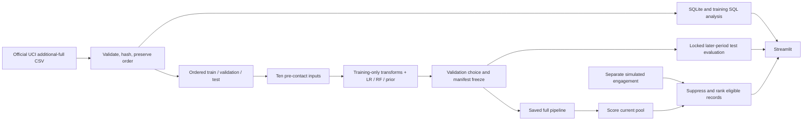

# Banking Customer Engagement & Deposit Propensity Analytics

**With limited contact capacity, which prospects should a relationship team review first for a term-deposit conversation?**

An independent portfolio project combining Python, Pandas, SQLite/SQL, scikit-learn and Streamlit. It turns historical campaign observations into a reviewable propensity ranking, campaign summaries and a capacity-based outreach simulation. The data is Portuguese telephone campaign history, **not ICICI Bank customer data or digital-channel engagement data**. Product suitability requires a separate needs assessment.

[Public source repository](https://github.com/Aditi1109luniya/banking-customer-engagement-analytics) · [Live interactive demo](https://bank-engagement-analyser.streamlit.app)

## Measured outcome

The validation-selected **Random Forest** captured **632 of 2,376** historical test subscriptions in the highest-scored **1,236 of 6,179 records**. Test Precision@20% was **51.13%**, Lift@20% **1.330×**, and Recall@20% **26.60%**. These are offline historical ranking results, not incremental sales.

Test ROC-AUC: **0.6186** · trapezoidal PR-AUC: **0.4737** · average precision (AP): **0.4740**. The model was frozen using validation results before test evaluation. It was not reselected on the test scores.

**The held-out comparison matters:** Logistic Regression achieved 59.95% test Precision@20%, 1.559× lift and 31.19% recall. The released Random Forest remains the choice fixed on validation (18.69% precision, versus 17.15% for Logistic Regression); we do not switch to the better-looking test model after seeing the holdout. This reversal is a limitation to explain, not a result to hide.

**Substantial temporal shift:** subscription prevalence was 5.57% (train) → 10.65% (validation) → 38.45% (test). A higher later-period precision does not itself show an improved model. Ranking generalization is limited, and the scores should not be presented as calibrated personal probabilities.


## What the application does

| Workspace | Useful behavior |
|---|---|
| Engagement hub | Default graphical welcome with an illustration, interactive previews from actual campaign/test artifacts, and direct navigation into analysis or outreach. |
| Campaign overview | SQL-backed counts, subscription rates and segments with denominators; training history is the development default. |
| Model results | Validation/test comparison, precision/recall/lift at a budget, gains curves, reliability, drift and descriptive group review. |
| Outreach shortlist | Historical replay, separate simulated suppression, eligible-pool budget controls, factual context, selected CSV and context JSON downloads. |
| Scoring sandbox | Synthetic one-record form and public/synthetic batch scoring with validation, unseen-category warnings and no upload persistence. |

The app loads a checksum-verified demo bundle; it does not train on startup. A simulated opt-out suppresses selection regardless of score. Neither the model nor simulation sends messages or contacts anyone.

The first screen is the **Engagement hub**. Its **Explore analysis →** and **Plan outreach →** buttons open the detailed workspaces. Three chart previews show historical campaign patterns, the frozen champion's test capacity/capture curve, and separately simulated outreach eligibility. The **Preview contact capacity (%)** slider changes the displayed budget point and simulated selected count without changing official metrics or the frozen model; **Open outreach shortlist** and **Plan outreach →** carry that percentage into the shortlist. Detailed pages provide **← Back to engagement hub** navigation; a raw record table is not the initial product experience. Hero artwork is illustrative and independent of ICICI Bank.

A visible navigation bar offers **Home**, **Campaign insights**, **Model results**, **Outreach**, and **Try scoring** on every page; the optional sidebar stays synchronized. Page links use `?view=home`, `?view=analysis`, `?view=model`, `?view=outreach`, or `?view=score`, so a copied URL can open a specific workspace. Changing pages returns to the heading; changing an analytical control preserves the current reading position. Chart previews stack into readable cards on smaller screens.

`ruff check .` and `pytest -q` passed in the delivery environment.

## Run the prepared demo

Use **Python 3.11** and run from the repository root. Exact runtime and development dependencies are committed in `requirements.txt` and `requirements-dev.txt`.

```bash
git clone https://github.com/Aditi1109luniya/banking-customer-engagement-analytics.git
cd banking-customer-engagement-analytics
```


```bash
python3.11 -m venv .venv
source .venv/bin/activate
python -m pip install -r requirements.txt
python -m pip install -e . --no-deps
python -m streamlit run app/streamlit_app.py
```

On Windows, replace activation with `.venv\Scripts\activate` in Command Prompt, or `.venv\Scripts\Activate.ps1` in PowerShell. Use `py -3.11` in place of `python3.11` when appropriate. The committed `demo/` bundle provides the data/model needed to use the app offline after dependencies are installed. The loader checks package versions against the model environment. Install the locked requirements when a version mismatch is reported. Load only the repository's trusted model files; never load uploaded pickle/joblib files.

## Reproduce from the official source

```bash
python -m pip install -r requirements-dev.txt
python -m pip install -e . --no-deps
python -m bank_engagement.cli fetch-data
python -m bank_engagement.cli prepare
python -m bank_engagement.cli analyze --split train
python -m bank_engagement.cli train
python -m bank_engagement.cli evaluate --split test
python -m bank_engagement.cli package-demo
python scripts/build_docs.py
ruff check .
pytest -q
```

`python -m bank_engagement.cli run-all` executes fetch → prepare → training SQL analysis → train/freeze → test evaluation → demo packaging in that order. Run `build_docs.py` afterwards for measured documentation. Initial acquisition requires internet; later `fetch-data` reuses verified cached source bytes. For a manually downloaded official ZIP, use `fetch-data --archive /path/to/bank+marketing.zip`. A manual `prepare --csv /path/to/bank-additional-full.csv` requires adjacent checksum-matching `provenance.json`; establish provenance with `fetch-data --archive` first.

Training and evaluation are guarded: an existing frozen selection is validated and reused, and a matching completed test evaluation is reused. Do not delete manifests to hide later changes. For a disclosed new experiment, preserve the old run and its evidence in a separate checkout/output snapshot before rebuilding. Preparing the SQLite database rebuilds its tables; the packaged demo remains a separate snapshot.

### Score a public or synthetic batch

```bash
python -m bank_engagement.cli score --input samples/prospects.csv --engagement samples/engagement_simulated.csv --output artifacts/scored.csv --capacity 5
```

Use `--fraction 0.20` instead of `--capacity` for a fraction of the eligible pool. `--min-score NUMBER` adds a cutoff while capacity remains a hard cap; use the frozen cutoff in `demo/manifest.json` for the documented policy. The CLI score CSV includes all safe scored records and a `selected` column; the app shortlist download contains selected rows only. Required input fields and safe export columns are documented in [the data dictionary](docs/data_dictionary.md). No real customer records or contact details belong in this demo.

## Pipeline and evaluation choices



| Partition | Records | Source row IDs | Subscriptions | Rate |
|---|---|---|---|---|
| train | 28,831 | 1–28,831 | 1,606 | 5.57% |
| validation | 6,178 | 28,832–35,009 | 658 | 10.65% |
| test | 6,179 | 35,010–41,188 | 2,376 | 38.45% |

All 41,188 source observations are retained, including repeats. IDs identify rows rather than unique customers. Training contains the earliest 70% (floor), validation the next 15% (floor), and test the remainder, in supplied order. Complete dates and real customer groups are not available.

The allowlist is `age`, `job`, `marital`, `education`, `default`, `housing`, `loan`, `previous`, `pdays`, `poutcome`. `pdays=999` creates a no-previous-contact indicator and a recency value filled from the training-only observed-recency median. One-hot categories and Logistic Regression scaling are fitted on training only. Duration, current-contact/campaign fields, economic indicators with unverified publication timing, outcome, IDs, split and simulation fields are excluded.

The fixed search has four Logistic Regression C values, four Random Forest depth/leaf combinations and one prior baseline. Selection uses validation Precision@20%, then AP, then Logistic Regression, then candidate ID. Finalists and champion are frozen before the held-out test is evaluated. Ranking ties use a label-independent SHA-256 key; capacity uses ceiling rounding. The no-information prior baseline uses the same tie policy. AP and trapezoidal PR-AUC are reported separately.

## Read and explain the project

- [Project understanding and interview guide](docs/project_understanding_and_interview_guide.md): complete pipeline, measured results, interview questions and pitches.
- [Model report](reports/model_report.md): exact selection, metrics, data quality, explanations and limitations.
- [Data dictionary](docs/data_dictionary.md): every raw field, derived feature, simulation and scoring contract.
- [Five-minute demo script](docs/demo_script.md): page-by-page interview walkthrough.
- [Implementation plan](plan.md): original build specification; historical planning language is retained.
- [Presentation](docs/presentation/): five-slide delivery and notes when generated.

Original source archives and bulk rebuild artifacts are ignored. The compact trusted `demo/` bundle, source, SQL, exact locks, tests, reports and figures are intended for reproducible delivery. The project has no paid API, LLM, CRM or external database dependency.

## Interpret the results responsibly

Historical ranking captures observed subscriptions under historical campaigns. It does not estimate the causal effect of outreach, revenue, product suitability or a digital channel's effectiveness. Subscription prevalence and observed profiles shift over time; scores are not guaranteed calibrated personal probabilities. Age/job group diagnostics are descriptive and support-limited, not a fairness certification. New deployment would require contemporary permissioned data, separate suitability and engagement controls, monitoring and a prospective controlled evaluation.

## Data and license

Use exactly [UCI Bank Marketing](https://archive.ics.uci.edu/dataset/222/bank+marketing), DOI [10.24432/C5K306](https://doi.org/10.24432/C5K306), `bank-additional-full.csv`. Dataset creators: Sérgio Moro, Paulo Rita and Paulo Cortez. The accompanying archive readme describes 41,188 ordered telephone-campaign observations from May 2008 to November 2010. The dataset is [CC BY 4.0](https://creativecommons.org/licenses/by/4.0/); [DATA_LICENSE.md](DATA_LICENSE.md) describes attribution and transformations. Original code: [MIT](LICENSE), copyright 2026 Aditi Luniya.

This independent portfolio prototype has no ICICI Bank affiliation or endorsement. No campus deck, employer branding, or private conversation is published.
