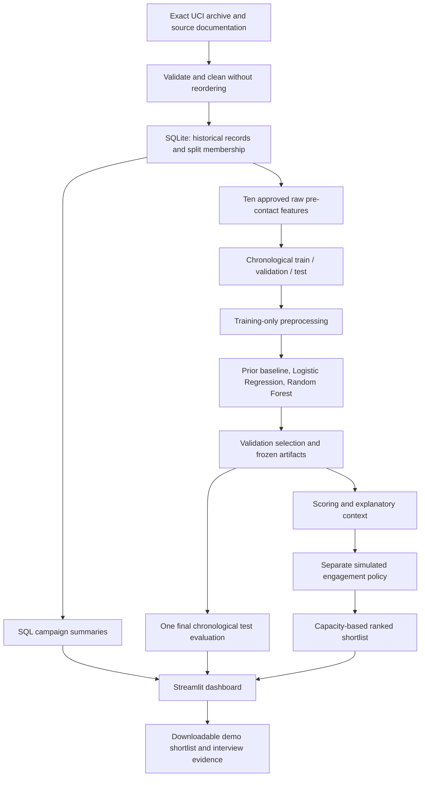

# Banking Customer Engagement & Deposit Propensity Analytics

<!-- BEGIN VERIFIED RESULTS -->
## Verified implementation results — read this first

**Status:** the local pipeline, frozen model artifacts and Streamlit prototype have been implemented. Numerical results below are read directly from the frozen evaluation. Test/hosting evidence must be checked from the actual delivery run; an old planning paragraph below is not evidence of execution.

`ruff check .` and `pytest -q` passed in the delivery environment.

[Public source repository](https://github.com/Aditi1109luniya/banking-customer-engagement-analytics) · [Live interactive demo](https://bank-engagement-analyser.streamlit.app)

The validation-selected **Random Forest** captured **632 of 2,376** historical test subscriptions in the highest-scored **1,236 of 6,179 records**. Test Precision@20% was **51.13%**, Lift@20% **1.330×**, and Recall@20% **26.60%**. These are offline historical ranking results, not incremental sales.

| Partition | Records | Source row IDs | Subscriptions | Rate |
|---|---|---|---|---|
| train | 28,831 | 1–28,831 | 1,606 | 5.57% |
| validation | 6,178 | 28,832–35,009 | 658 | 10.65% |
| test | 6,179 | 35,010–41,188 | 2,376 | 38.45% |

| Split / model | PR-AUC¹ | AP² | ROC-AUC | Precision@20% | Lift@20% | Recall@20% | Captured / shortlisted | Brier ↓ |
|---|---|---|---|---|---|---|---|---|
| validation / Logistic Regression | 0.1669 | 0.1682 | 0.6001 | 17.15% | 1.610 | 32.22% | 212 / 1,236 | 0.0959 |
| test / Logistic Regression | 0.5223 | 0.5226 | 0.6219 | 59.95% | 1.559 | 31.19% | 741 / 1,236 | 0.3060 |
| validation / Random Forest ★ | 0.1896 | 0.1907 | 0.6206 | 18.69% | 1.755 | 35.11% | 231 / 1,236 | 0.0949 |
| test / Random Forest ★ | 0.4737 | 0.4740 | 0.6186 | 51.13% | 1.330 | 26.60% | 632 / 1,236 | 0.3092 |
| validation / Prior baseline | 0.5533 | 0.1065 | 0.5000 | 11.08% | 1.041 | 20.82% | 137 / 1,236 | 0.0977 |
| test / Prior baseline | 0.6923 | 0.3845 | 0.5000 | 37.62% | 0.978 | 19.57% | 465 / 1,236 | 0.3448 |

**The held-out comparison matters:** Logistic Regression achieved 59.95% test Precision@20%, 1.559× lift and 31.19% recall. The released Random Forest remains the choice fixed on validation (18.69% precision, versus 17.15% for Logistic Regression); we do not switch to the better-looking test model after seeing the holdout. This reversal is a limitation to explain, not a result to hide.

**Substantial temporal shift:** subscription prevalence was 5.57% (train) → 10.65% (validation) → 38.45% (test). A higher later-period precision does not itself show an improved model. Ranking generalization is limited, and the scores should not be presented as calibrated personal probabilities.

The champion was `rf-d8-l10-32e674d224` with `{"class_weight": null, "max_depth": 8, "max_features": "sqrt", "min_samples_leaf": 10, "n_estimators": 300, "n_jobs": 2, "random_state": 42}`. Choose validation Precision@20%, then AP, then Logistic Regression, then stable candidate ID. Do not pick a model again from the test table. PR-AUC here is trapezoidal; AP is the separate non-interpolated average precision. The all-test ranking metrics precede simulation and use 1,236 shortlisted records.

The frozen validation cutoff is **0.067922**. Applying `score >= cutoff` on test selected **3,336** records (53.99% coverage), with 46.64% precision and 65.49% recall. This is a separate policy from the exact top-20% shortlist. Ties at the cutoff can increase its volume; a new population can change it further.

The score budget and fixed score cutoff are different policies. In the dashboard's operational simulation, suppress ineligible records first and calculate capacity from the eligible pool. Percentage budgets use ceiling rounding. An opt-out changes eligibility, never the underlying score. Source row IDs are observation IDs, not unique bank customers.

Training-only previous-outcome summary: `nonexistent`: 1,543 subscriptions / 27,829 observations (5.54%); `failure`: 56 subscriptions / 952 observations (5.88%); `success`: 7 subscriptions / 50 observations (14.00%). These are descriptive associations with explicit denominators.

The three largest validation permutation-AP decreases are age (0.0296), pdays (0.0132), job (0.0070). This is a global sensitivity check, not causation or an individual customer's explanation. Full measured diagnostics and data quality are in [the model report](../reports/model_report.md). Quality checks retained 12 extra exact duplicate rows; 0 exact-row fingerprints crossed the split boundary. This cannot rule out repeat customers with differing rows.

### Completed-project 90-second interview answer

“I built an independent banking analytics prototype to help relationship teams prioritize a limited term-deposit contact budget. I used 41,188 public Portuguese telephone-campaign observations, preserving their order in a 70/15/15 split. Python handles preparation, SQLite answers campaign questions, scikit-learn trains models, and Streamlit delivers the workflow.

“Pre-contact scoring uses ten profile and previous-campaign inputs, excluding call duration and current-contact fields. I compared Logistic Regression and Random Forest. Random Forest won validation Precision@20%. On 6,179 later test observations, its 1,236-record shortlist captured 632 of 2,376 subscriptions: 51.13% precision, 26.60% recall and 1.33 times lift.

“Logistic Regression did better on test, at 59.95% precision. I report the reversal while keeping the validation choice fixed. Prevalence shifted from 5.57% in training to 38.45% in test, so contemporary validation is essential.

“The dashboard separates scores from simulated opt-out and permission rules, which are not recorded consent. I show reliability, drift and support-limited group checks. Scores support a needs-based conversation, not suitability or causal sales claims. This uses no ICICI customer data and is not an ICICI deployment.”

### Commands and evidence to show

```bash
python -m bank_engagement.cli run-all
python scripts/build_docs.py
python -m streamlit run app/streamlit_app.py
python -m bank_engagement.cli score --input samples/prospects.csv --engagement samples/engagement_simulated.csv --output artifacts/scored.csv --capacity 5
ruff check .
pytest -q
```

Run from the root after the locked Python 3.11 install in [README](../README.md). `demo/manifest.json` identifies the model and bundle checksums; `demo/metrics.json` is the measured comparison; `data/raw/provenance.json` records the exact source. Existing matching train/evaluate stages are reused; do not edit the final holdout to tune the story.

The rest of this guide teaches the reasoning and includes explicitly hypothetical arithmetic. Use the verified numbers above for the completed project, not hypothetical example numbers. Historical planning instructions below explain the original intended workflow.
<!-- END VERIFIED RESULTS -->


## Project understanding and ICICI interview guide

**Status: implemented and evaluated prototype.** Read the verified results section above first. Original worked arithmetic examples below remain explicitly hypothetical. Use [the implementation plan](../plan.md) for design intent and the [README](../README.md) for runnable commands.

This guide explains what the system does, how data moves through it, why the technical choices matter, and how to discuss the work honestly in an interview. Start with Sections 1–4 for the business story; continue through Sections 5–12 for the technical pipeline; use the remaining sections to prepare your explanation and demo.

**Reading route:** understand the business in Sections 1–4, study the pipeline in 5–13, and rehearse with 14–20. The glossary is in Section 21. Give the build agent [plan.md](../plan.md); use this guide to question and verify its work.

<details>
<summary>Contents</summary>

- [1. The business problem in one sentence](#1-the-business-problem-in-one-sentence)
- [2. What makes the ICICI connection credible](#2-what-makes-the-icici-connection-credible)
- [3. What data you actually have](#3-what-data-you-actually-have)
- [4. The complete pipeline](#4-the-complete-pipeline)
- [5. Cleaning, data contracts, and SQLite](#5-cleaning-data-contracts-and-sqlite)
- [6. Features and the scoring-time boundary](#6-features-and-the-scoring-time-boundary)
- [7. Chronological evaluation and preprocessing](#7-chronological-evaluation-and-preprocessing)
- [8. The models and how selection works](#8-the-models-and-how-selection-works)
- [9. Metrics: what each number tells you](#9-metrics-what-each-number-tells-you)
- [10. Capacity, thresholds, and engagement policy](#10-capacity-thresholds-and-engagement-policy)
- [11. Explaining patterns without overstating them](#11-explaining-patterns-without-overstating-them)
- [12. What the five dashboard pages do](#12-what-the-five-dashboard-pages-do)
- [13. How to know the implementation is trustworthy](#13-how-to-know-the-implementation-is-trustworthy)
- [14. Limitations and sensible next steps](#14-limitations-and-sensible-next-steps)
- [15. Interview pitches](#15-interview-pitches)
- [16. A five-minute interview demo](#16-a-five-minute-interview-demo)
- [17. Five-slide presentation storyboard](#17-five-slide-presentation-storyboard)
- [18. Interview questions and answer patterns](#18-interview-questions-and-answer-patterns)
- [19. Study and evidence checklist](#19-study-and-evidence-checklist)
- [20. Resume language after completion](#20-resume-language-after-completion)
- [21. Compact glossary](#21-compact-glossary)
- [22. References and source boundaries](#22-references-and-source-boundaries)

</details>

## 1. The business problem in one sentence

**When the relationship team has limited capacity, which prospects should it prioritize for a term-deposit conversation?**

The system assigns an estimated subscription propensity to each record, ranks records, and helps a relationship manager choose an outreach shortlist within a stated capacity. It also summarizes historical campaign patterns and evaluates how many observed subscriptions are concentrated near the top of the ranking.

For this prototype, a term deposit is the product in the historical campaign target. Product terms, current rates, eligibility, and personal financial advice are outside the model. A high score does not establish that the product suits a customer, that the customer consents to contact, or that contact will cause a subscription.

The intended user is a relationship manager or campaign analyst. Their practical workflow is:

1. Review the available candidate records and historical context.
2. Set contact capacity, such as a maximum number of records.
3. Apply the separate simulated engagement policy.
4. Review the ranked eligible shortlist and its supporting context.
5. Download the shortlist for a demonstration of a downstream workflow.

The prototype does not call, email, message, or notify anyone. It does not contain real contact details.

## 2. What makes the ICICI connection credible

The connection is the business workflow: customer understanding, useful prioritization, responsible engagement, and a practical delivery interface.

| Campus deck theme | How this project relates | What you should say carefully |
|---|---|---|
| Slide 3: digital offerings and AI for customer engagement | A dashboard makes analytical prioritization usable in a relationship workflow | The source data describes telephone campaigns; digital delivery examples are simulated |
| Slide 8: Customer 360, fairness, risk/compliance, sales and relationships | The demo combines customer context, ranking, policy overrides, and limitations | This is a limited customer view, not a complete Customer 360 platform |
| Slide 10: indicative business groups and a sales orientation for all roles | The project connects technical execution to a sales and relationship question | Groups do not confirm your role allocation; the bank retains role and location discretion |

These are paraphrases of the campus material supplied for this task. Keep the original employer PDF private; do not copy its pages or logos into a public repository. Describe the project as **an independent banking analytics prototype aligned with the campus deck**. Do not describe it as an ICICI implementation or imply endorsement.

## 3. What data you actually have

Use **`bank-additional-full.csv`**, a semicolon-delimited file containing **41,188 historical campaign records**, 20 original input columns, and the target `y`. The supplied rows are ordered by date, covering May 2008 to November 2010. This is Portuguese bank telephone-campaign data. UCI distributes several related files, so verify this exact filename and its bundled documentation rather than accidentally using the older 45,211-row version. [UCI Bank Marketing](https://archive.ics.uci.edu/dataset/222/bank+marketing)

One row is an observed campaign record. The file provides no reliable customer identifier. Create an immutable surrogate such as `record_id` from original row position for joins and traceability; it does not identify a real customer or prove that two rows represent different people. Preserve source order and all rows. Do not silently deduplicate apparently identical records or manufacture names, phone numbers, exact timestamps, or account balances.

The target is binary: `yes` becomes 1 and `no` becomes 0. It records historical subscription outcome. During scoring, `y` is absent from model input. In a historical replay it can be used afterward to evaluate the ranking, with explicit separation from the operational-style shortlist.

The dataset does **not** provide app sessions, website clicks, email opens, notification responses, consent, current investment needs, or an untreated comparison group. Those absences determine what the project can claim.

## 4. The complete pipeline



Read the diagram as: **acquire → validate → assign chronological splits → store → analyze training data → train → choose → evaluate → score → apply policy → prioritize → explain**. SQL summarizes what happened historically. Machine learning estimates a ranking. The policy layer determines whether outreach is permitted in the simulation. Streamlit makes these outputs inspectable.

| Stage | Input | Action | Output and purpose |
|---|---|---|---|
| Acquisition | Official archive | Record provenance, verify filename and checksum | Repeatable source snapshot |
| Cleaning | Original CSV | Validate schema and categories; preserve rows/order | Trusted historical table |
| SQL analysis | SQLite records | Aggregate counts, outcomes, and denominators | Campaign context |
| Feature preparation | Approved columns | Derive safe representations | Model-ready inputs |
| Training | Earliest rows | Fit preprocessing and candidate estimators | Fitted pipelines |
| Selection | Middle rows | Compare candidates at a fixed outreach budget | Frozen model and cutoff |
| Evaluation | Latest rows | Measure once using frozen decisions | Honest historical holdout results |
| Scoring | Valid candidate records | Load pipeline and predict scores | Ranked propensity estimates |
| Engagement simulation | Scores plus simulated policy fields | Suppress ineligible records before capacity selection | Practical demo shortlist |
| Delivery | Summaries, metrics, shortlist | Display, explain, and export | Relationship-manager dashboard |

Git records code and configuration changes throughout. A reproducible run should establish exactly which data, code, package versions, features, and model produced each result.

## 5. Cleaning, data contracts, and SQLite

Cleaning is about consistent interpretation, not making the dataset look convenient. Read the file using the correct separator, check expected columns and row count, validate `y`, and assign the surrogate ID before transformations. Record malformed inputs as errors rather than silently dropping them. Keep the raw file immutable.

Distinguish three cases:

- **An explicit category `unknown`:** preserve it as a meaningful recorded state; it is not the same as a known `no`.
- **A genuine missing value in a new scoring input:** process only according to the documented input contract, without guessing a business fact.
- **A sentinel such as `pdays=999`:** interpret using this file's dictionary; it means no previous contact recorded for this field, not a literal 999-day interval.

The exact dataset's bundled readme is the authority for category and sentinel meanings. Do not copy the older dataset's `pdays=-1` convention into this version.

Use SQLite because it is local, inspectable, and sufficient for roughly forty thousand records. Pandas is convenient for validation and machine-learning input; SQL makes business aggregations explicit and reusable. There is no need for a distributed database.

Keep historical records, split assignments, model scores, and simulated engagement fields logically separate. Join using `record_id` and, where needed, run/model identifiers. The persistent score table contains canonical UCI records and ranks within their fixed splits. Uploaded records and filtered rankings remain transient and never overwrite those canonical scores. A simulated policy table should make its origin unmistakable. A one-to-many join must not multiply historical rows unnoticed.

### A useful SQL question

“How do observed subscription rates differ by previous campaign outcome?” This query uses the tables specified in the implementation plan:

```sql
SELECT
    c.poutcome,
    COUNT(*) AS records,
    SUM(c.y) AS subscriptions,
    ROUND(
        100.0 * SUM(c.y)
        / NULLIF(COUNT(*), 0),
        2
    ) AS subscription_rate_pct
FROM clean_campaigns AS c
JOIN dataset_splits AS s USING (record_id)
WHERE s.split = 'train'
GROUP BY c.poutcome
ORDER BY subscription_rate_pct DESC, c.poutcome;
```

The denominator is **all training records in each outcome group**, not all subscriptions and not the full dataset. `100.0` forces floating-point arithmetic; `NULLIF` protects a denominator that could be zero in other query designs. Display the count next to the rate: a small group can have an unstable rate.

This query describes an association. It does not show that changing a previous outcome would change a future subscription. Use training-only target-based SQL/EDA during development; validation is reserved for the predefined candidate comparison and diagnostics. A full historical overview may be generated after the model decisions are frozen, clearly identified as descriptive.

## 6. Features and the scoring-time boundary

Define the decision point first: **the score is produced before a proposed new contact**. A feature is usable only if it would already be known then. A column existing in the CSV is insufficient evidence that it was available at that point.

The v1 model uses these ten raw features:

| Feature group | Raw fields | What they contribute |
|---|---|---|
| Customer context | `age`, `job`, `marital`, `education` | Limited recorded profile information |
| Recorded credit/loan context | `default`, `housing`, `loan` | Historical categorical statuses; not a suitability assessment |
| Previous campaign history | `previous`, `pdays`, `poutcome` | Prior-contact count, recency representation, and prior outcome |

Exclude these ten original columns from the v1 estimator:

- `duration`: known after the call, so it directly violates pre-contact scoring.
- `contact`, `month`, `day_of_week`, `campaign`: current-contact/campaign information whose proposed-contact availability is not established.
- `emp.var.rate`, `cons.price.idx`, `cons.conf.idx`, `euribor3m`, `nr.employed`: macroeconomic fields whose exact as-of availability is not verified for this design.

Some excluded variables might be defensible in a different operational definition. The current decision is deliberately conservative and reproducible. Never quietly restore them to obtain a better metric. Exclude the target, IDs, split labels, simulated policy fields, and derived outcomes as well.

For `pdays`, derive an explicit prior-contact indicator and a numeric recency field with the sentinel represented as missing. Impute recency using training data only; retain the indicator so “no prior contact” stays distinguishable from an observed interval. Do not replace 999 with zero and pretend the customer was contacted today. Document this transformation and test it identically in training and scoring.

Age and other profile variables can encode sensitive relationships or proxies. Their presence is an analytical choice to disclose and audit, not a statement that every real bank should use them in every outreach decision.

## 7. Chronological evaluation and preprocessing

Use original row order with zero-based Python slices:

| Purpose | Slice | Records | What may happen here |
|---|---|---:|---|
| Training | `[0:28831]` | 28,831 | Fit preprocessing and candidate models |
| Validation | `[28831:35009]` | 6,178 | Select model and establish diagnostic score cutoff |
| Test | `[35009:41188]` | 6,179 | Final evaluation of frozen choices |

Compute the training count as `floor(0.70 × N)`, the validation count as `floor(0.15 × N)`, and assign the remainder to test. For this dataset, the resulting boundaries are 28,831 and 35,009. The three slices must be disjoint, cover every row exactly once, and preserve order.

A random split would mix earlier and later campaign conditions. A chronological holdout better resembles using past observations to score later records. It is still imperfect: source order is available, exact event timestamps and reliable customer identity are not. The split cannot prove that the same underlying customer never appears on both sides.

### What “fit preprocessing on training only” means

The derived recency field needs an imputation value for the no-previous-contact state. Compute that median from non-sentinel training observations only. Computing it from the test set lets future data influence the pipeline. Similarly, learning categories, scaling statistics, or feature selection from the full dataset contaminates evaluation. In this project's batch contract, missing or invalid raw numeric values are rejected rather than silently filled.

Use a scikit-learn `Pipeline` containing feature preparation, a `ColumnTransformer`, and the estimator. Numeric transformations and imputers learn from training data. Categoricals use one-hot encoding with documented handling for unseen categories. Logistic Regression receives appropriately scaled numeric inputs; a forest does not require numeric scaling. Validation, test, and scoring inputs call the fitted pipeline's transformation and prediction operations without fitting again. This separation is a central defense against leakage. [scikit-learn common pitfalls](https://scikit-learn.org/stable/common_pitfalls.html)

One-hot encoding converts a category into indicator columns rather than inventing an ordering such as “student < technician < retired.” A category first seen at scoring time must not crash the app or lead to fitting a new encoder on the uploaded data. Make its handling visible in input validation and documentation.

Keep notebooks optional for exploration. The authoritative pipeline should run from scripts or CLI commands so that training does not depend on manually executed notebook cells.

## 8. The models and how selection works

### The simple baseline

A prior baseline gives every record the same score: the training subscription rate. It asks whether the learned model adds useful ranking information beyond a constant prediction. Because every score ties, its top-budget ordering is arbitrary; use the project's deterministic SHA-256 tie rule and report the realized shortlist. Separately show an analytical random-contact reference: expected precision equals population prevalence, expected lift is 1, and expected recall is k/N. These expectations are not measured results from a new random model.

Do not confuse a constant predictor with a strong ranking baseline. Its value is an explicit reference and a check that metric code behaves sensibly.

### Logistic Regression

Despite its name, Logistic Regression is a classification model. It combines features into a linear score and maps that score through a sigmoid to an estimated probability between 0 and 1. Regularization limits overly large coefficients.

It is fast, comparatively simple to explain, and provides a useful baseline among learned models. It may miss nonlinear patterns unless those relationships are represented in the inputs. A positive coefficient means a higher model log-odds contribution under that fitted representation; it does not prove causation or customer suitability.

### Random Forest

A Random Forest combines many decision trees built with randomness in their training samples and feature choices. Trees can capture nonlinear patterns and interactions; averaging their outputs reduces instability compared with one tree.

Forests need controls such as depth and minimum leaf size to limit overfitting. They are more complex to explain and can produce poorly calibrated scores. Neither model wins by definition. Compare their observed validation behavior under the same feature boundary and splits.

### The frozen decision rule

Evaluate the predefined candidate configurations on validation data. Within each model family and between finalists, select the highest **validation Precision@20%**. If tied to numerical tolerance `1e-12`, use validation Average Precision. On a remaining cross-family tie, prefer Logistic Regression for simplicity; within a family, use candidate ID in lexicographic order.

Do not select the winner using test performance. Do not repeatedly expand the search after inspecting test failures. Do not refit on training plus validation in v1: save the selected pipeline already fitted on the original training slice. This keeps the final tested artifact and the dashboard artifact identical.

If neither learned model beats the relevant references, report that result. A project can demonstrate sound engineering and judgment without a promised performance improvement.

## 9. Metrics: what each number tells you

Let `N` be evaluated records, `P` observed subscriptions, and `k = ceil(0.20 × N)`. Sort scores descending with a deterministic, label-independent tie-break. Let `TP_k` be the subscriptions among the first `k` records.

| Metric | Definition | Practical interpretation |
|---|---|---|
| Test subscription rate | `P / N` | Historical prevalence in this evaluation slice |
| Precision@20% | `TP_k / k` | Observed subscription rate within the top-budget shortlist |
| Recall@20% | `TP_k / P` | Share of all observed subscriptions represented in that shortlist |
| Lift@20% | `Precision@20% / (P/N)` | Concentration relative to the slice's overall rate |
| ROC-AUC | Area under the true-positive-rate versus false-positive-rate curve | How well scores order positive above negative records across thresholds |
| PR-AUC, trapezoidal | Trapezoidal integration of precision against recall | Summary of the precision–recall curve with a stated interpolation rule |
| Average Precision, AP | Recall-increment-weighted precision | A separate precision–recall summary without trapezoidal interpolation |

For the 6,179-row test slice, the 20% budget is **1,236 records**. Report that exact denominator. Precision is not the same as recall: one divides by selected records, the other by all positive records. Lift depends on the population prevalence, so a lift value without its evaluation population is incomplete.

### Hypothetical example — not a measured project result

Imagine 1,000 historical records containing 100 subscriptions. The highest-scored 200 contain 40 subscriptions:

- Overall rate: `100 / 1,000 = 10%`.
- Precision@20%: `40 / 200 = 20%`.
- Lift@20%: `20% / 10% = 2.0`.
- Recall@20%: `40 / 100 = 40%`.

This ranking concentrates 40 of the already observed subscriptions within 20% of the records. It does **not** mean outreach caused 40 subscriptions, doubled sales, or increased revenue. Randomly selecting 200 records would capture 20 subscriptions on average under this illustrative population, with sampling variation.

### PR-AUC and AP must not be relabelled

Use `precision_recall_curve` followed by `auc(recall, precision)` for the requested trapezoidal PR-AUC, and `average_precision_score` for AP. Save both with distinct names. Scikit-learn explains that AP differs from trapezoidal integration, whose interpolation can be optimistic. [Average Precision documentation](https://scikit-learn.org/stable/modules/generated/sklearn.metrics.average_precision_score.html)

A useful trap to understand: a constant-score predictor has AP equal to evaluation prevalence, but its trapezoidal PR-AUC can be much higher because the curve includes endpoint conventions and linear interpolation. Do not announce that the constant prior “performs well” based on that artifact. Display the curve, the metric definition, and the random-budget reference together. [Precision–recall curve documentation](https://scikit-learn.org/stable/modules/generated/sklearn.metrics.precision_recall_curve.html)

Accuracy is not the headline because predicting the majority class can look accurate while providing no useful shortlist. AUC summaries are helpful, but the fixed-budget metrics directly answer the stated capacity question. Scores are estimates, not a promise that every group assigned 0.30 will subscribe at exactly 30%.

## 10. Capacity, thresholds, and engagement policy

### Capacity-based ranking

At a chosen fraction `q`, select exactly `ceil(q × N)` records from the evaluated population, with zero records selected for zero capacity or an empty population. Resolve score ties using the SHA-256 hash of "42:<record_id>", then the ID, rather than the target or Python's randomized hash. In the relationship-manager demo, apply simulated suppression first, then rank the eligible population and take at most integer capacity `K`. If only 12 records are eligible and capacity is 20, return 12. Do not fill spare places with suppressed records.

Keep **headline historical top-20% evaluation** separate from **policy-filtered demo selection**. Applying simulated opt-outs changes the population and denominator. It would make a new, explicitly labelled analysis rather than replacing the published test metric.

### A frozen score cutoff

On validation data, record the score at the `ceil(0.20 × N_validation)` position as cutoff `t`. Apply that same number to test scores as a diagnostic. The resulting volume need not be 20% because later scores may have a different distribution; score ties may also expand the selected set.

Show realized count, precision, and recall for this frozen cutoff. Do not retune `t` on test labels. In an optional dashboard cutoff mode, also cap the final eligible list at `K`. A fixed score cutoff and an exact capacity rule answer different operational questions; neither is a proven profit optimum.

### The separate simulated policy

The v1 policy fields are simulated opt-out, simulated contact permission, and simulated recent contact. They are generated deterministically from record IDs independently of labels and scores, never used as model features, and never treated as historical facts. Eligibility requires permission, no opt-out, and no recent-contact flag. Missing supplied policy flags suppress the record. Parse flag values explicitly: true/false or 1/0; a programming shortcut such as bool("false") would incorrectly treat that nonempty text as true. An explicit simulated opt-out suppresses a record regardless of its score. Display every suppression reason and a clearly labelled simulated origin. Any digital-channel examples are future simulated workflow concepts, not an implemented channel recommendation.

The model answers “how strongly does this resemble historical subscribers?” The policy answers “may this record enter this demonstration shortlist?” A relationship manager still needs an appropriate customer conversation, product checks, and genuine permissions in any real deployment.

## 11. Explaining patterns without overstating them

Use three layers of explanation:

1. **Descriptive patterns:** SQL group counts and observed rates, with denominators and split labels.
2. **Global model behavior:** Logistic Regression coefficients and/or validation permutation importance, using careful feature grouping and the selected preprocessing representation.
3. **Record context:** the candidate's actual approved input values and prior-history context, alongside its score and policy status.

Permutation importance asks how validation performance changes when one feature is shuffled. Correlated features can share or hide importance, and shuffling can create unrealistic combinations. Forest impurity importance has its own biases; do not treat it as definitive evidence of customer behavior.

A global importance chart does not explain why one particular record received its exact score. Unless a verified local explanation method is implemented and tested, label shortlist text as **record context**, not “top causes of this prediction.” Avoid invented explanations such as “this customer will subscribe because they are retired.” Never generate a sales argument from sensitive attributes.

Audit performance and selection patterns across sufficiently supported groups, display counts, and discuss uncertainty. A low observed subscription rate does not justify unfair exclusion. The dataset is too limited to establish comprehensive fairness or legal compliance. Removing one demographic field also does not eliminate its proxies.

## 12. What the five dashboard pages do

The default **Engagement hub** is a graphical product welcome. It introduces the business question with an illustration and interactive chart previews, then provides clear routes to the analytical tools. The first visit begins with the decision and visual evidence rather than a raw records table. Hero artwork is illustrative and independent of ICICI Bank. All chart values come from the actual trusted public-data/model bundle, while eligibility is explicitly simulated.

| Page | What the user sees | What you explain in the demo |
|---|---|---|
| Engagement hub | Welcome illustration, campaign-pattern bars, test capacity/capture curve, simulated outreach donut, budget slider and navigation buttons | A quick route from the business question to real historical evidence; simulation stays separate |
| Campaign overview | Data provenance, record counts, target distribution and SQL segment summaries | These are historical associations with visible denominators |
| Model results | Split sizes, feature boundary, baseline/LR/RF comparison, curves, budget trade-off and limitations | Selection used validation; the later slice was held out |
| Outreach shortlist | Capacity, simulated policy controls, eligible/suppressed counts, sorted records and export | Policy is applied before capacity; the score supports prioritization |
| Scoring sandbox | Synthetic single-record input or schema-validated upload using the saved pipeline | New inputs reuse the fitted transformations; no training occurs here |

The hub hero buttons are **Explore analysis →**, which opens Campaign overview, and **Plan outreach →**, which opens Outreach shortlist. The three previews are **Campaign patterns** (full-history previous-outcome subscription rates), **Capacity & capture** (the frozen champion's test cumulative-gains curve, random reference and budget point), and **Simulated outreach** (test-pool eligible/suppressed shares and selected count). Their buttons are **Open campaign analysis**, **Open model results**, and **Open outreach shortlist**. **Preview contact capacity (%)** spans 1–50%, starting at 20%; it changes the preview budget point and simulated count without altering the official frozen metrics or model. **Open outreach shortlist** and **Plan outreach →** carry that chosen percentage into the shortlist control. Analytical pages return through **← Back to engagement hub**. Full-history descriptions are appropriate here because selection is already frozen; development-stage analysis remains training-only.

The visible navigation bar offers **Home**, **Campaign insights**, **Model results**, **Outreach**, and **Try scoring**. It stays in step with the optional sidebar and page URL. Shareable page links use `?view=home`, `?view=analysis`, `?view=model`, `?view=outreach`, or `?view=score`. The header and preview cards adapt to smaller screens. A page change returns to its heading; an ordinary filter or capacity adjustment keeps the reading position.

All five pages identify the historical public-data prototype and model run. Results come from stored evaluation artifacts; a missing/incompatible bundle produces a helpful setup message rather than fabricated numbers. Loading the saved pipeline verifies hashes and compatible package metadata. Only trusted local serialized artifacts are loaded: model files can execute code during deserialization.

The sandbox model receives only approved raw features. Separate optional simulated policy inputs go to the eligibility layer. A single-record form assigns a synthetic session ID; batch CSVs require unique record IDs. Age, previous and pdays must be finite integer-valued inputs with documented bounds. Known excluded source columns such as duration or y are ignored with warnings and never forwarded to the estimator; unexpected or malformed fields reject the batch. Operational-style exports omit historical targets and personal contact details. A clearly labelled historical replay supports teaching and evaluation.

Streamlit delivers the welcome, analytics and scoring in one application. A public demo is available through the verified link in the results section; local execution and the trusted saved bundle provide the interview fallback. The prototype needs no live bank integration or customer-contact service.

## 13. How to know the implementation is trustworthy

You should be able to trace a downloaded shortlist record back to its source row, model run, input feature values, score, and simulated eligibility decision. That trace is more convincing than an attractive dashboard alone.

The implementation should prove these behaviors:

- The exact data file has the expected shape; ingestion does not change source order or row count.
- Splits have the specified sizes, no overlaps, and complete coverage.
- Forbidden features cannot enter the estimator or scoring contract.
- Preprocessing statistics come from training only, including sentinel handling.
- Validation/test transformations do not alter fitted parameters.
- Model selection is deterministic and never uses test labels.
- Metric calculations pass small hand-checkable examples, including ties and no-positive cases.
- A saved and reloaded pipeline returns the same scores on the same inputs.
- A simulated opt-out always suppresses, even with a very high score.
- Capacity is respected, exports are correctly ordered, and missing artifacts fail clearly.

If an evaluation slice has no positives, recall, AP-related interpretation, and lift require explicit undefined handling; if only one class exists, ROC-AUC is undefined. Do not convert an undefined metric into a plausible-looking zero. Those tests matter even if the official dataset's normal slices contain both classes.

Keep a run manifest, model report, data dictionary, dependency lock, and clear README. Record measured values automatically from the same artifacts used by the dashboard. Do not manually type a better-looking score into a slide. Git history, automated checks, and a clean-environment reproduction command turn a classroom experiment into an inspectable engineering project.

## 14. Limitations and sensible next steps

The data is old, from another country and institution, and reflects a historically selected contacted population. A chronological holdout estimates performance on later rows from that source; it does not validate use on current Indian banking customers or on all uncontacted prospects. Missing stable customer IDs limit identity-level leakage checks.

The feature boundary sacrifices potentially predictive information to respect the defined decision time. Previous-history fields still need verified live snapshots in a real system. Profile variables and proxies require governance review. Scores may drift or be miscalibrated. Feature associations do not reveal customer needs, channel preferences, or causal responses.

Potential extensions, after a reliable v1, include verified as-of economic data, better live identity and event snapshots, rolling-origin evaluation, calibration using a separate chronological window, and monitoring for score/input/outcome drift. A deployment would need delayed-outcome tracking, genuine permissions, identity security, access controls, audit logs, and documented human responsibilities.

To estimate incremental benefit, propose a prospective randomized evaluation among appropriately eligible customers, with a justified treatment/control design and observed outcomes. To learn who benefits *because of contact*, uplift modeling needs treatment information and suitable causal assumptions or randomized data. This dataset and ordinary propensity scores cannot answer that question alone. Do not invent an uplift or revenue result for the prototype.

## 15. Interview pitches

### Thirty seconds — usable before implementation

“I am developing an independent banking engagement prototype that prioritizes term-deposit prospects when relationship-manager capacity is limited. It uses public Portuguese campaign data, Python and SQL analysis, and a comparison of Logistic Regression with Random Forest. The design excludes call duration, preserves chronological evaluation, and separates simulated engagement permissions from model scores. The Streamlit workflow is intended to make the ranking explainable and practical. I will report historical precision, recall, and lift after implementation.”

After completing the work, replace “am developing” with an accurate completed-work description and add only verified results.

### Ninety seconds — structure to personalize after completion

“The business question was which prospects to prioritize when the team can contact only a limited number of records. I used the exact 41,188-record UCI bank-additional file, which describes historical Portuguese telephone campaigns. I validated the file, stored records in SQLite, and wrote SQL summaries with explicit denominators.

“For modeling I defined scoring before a new contact. I used ten approved profile and previous-history inputs, excluding call duration and other fields whose availability was not established. I trained Logistic Regression and Random Forest pipelines on the earliest 70%, selected on the next 15%, and evaluated the frozen choice on the latest 15%. On the 6,179-record chronological test, the top 1,236 achieved 51.13% precision, 26.60% recall and 1.330× lift; see the frozen metrics and model report.

“The dashboard explains historical patterns, shows model results, and creates a capacity-limited shortlist after separate simulated policy checks. An opt-out overrides a high score. The ICICI relevance is customer understanding and a useful sales-support workflow; the data is not ICICI data, propensity is not suitability, and the evaluation does not prove incremental sales.”

### A deeper technical answer

Walk through one record: source row → surrogate ID → split → approved features → sentinel transformation → fitted encoder/scaler → selected estimator → score → deterministic rank → simulated eligibility → capacity selection → export. Then explain why test data never influences fitting or selection. End by pointing to the report and actual reproducibility command, in the implemented repository.

## 16. A five-minute interview demo

| Time | Action | Key sentence |
|---|---|---|
| 0:00–0:40 | Begin at Engagement hub: state the problem, inspect chart previews and adjust preview capacity | “These charts use frozen historical artifacts; eligibility is simulated.” |
| 0:40–1:25 | Click Explore analysis → or Open campaign analysis; show one SQL segment chart | “I show the denominator because rates from tiny groups are unstable.” |
| 1:25–2:25 | Show splits, feature exclusions, comparison, and budget curve | “The winner was selected on validation, with a frozen chronological test.” |
| 2:25–3:35 | Set capacity and inspect shortlist | “This is a ranking workflow; a simulated opt-out is suppressed first.” |
| 3:35–4:20 | Score a synthetic sandbox record | “The saved pipeline applies the same transformations used in training.” |
| 4:20–5:00 | Show limitations and next experiment | “Historical lift does not establish the causal benefit of outreach.” |

Prepare a local fallback with saved screenshots and the measured report. Do not improvise missing results, depend on a live download, or upload personal information during the interview. Show two or three clear behaviors rather than clicking through every control.

## 17. Five-slide presentation storyboard

1. **Business question and relevance:** limited capacity, RM audience, term-deposit conversation; a brief paraphrased link to the campus engagement themes.
2. **Data and pipeline:** exact public source, source-order split, architecture diagram, public-data and simulation labels.
3. **Leakage and evaluation:** approved features, duration/current-contact exclusion, training-only preprocessing, chronological holdout, and validation selection rule.
4. **Measured findings:** actual metric table for the prior baseline and both model families; validation-selected champion; precision, lift, and recall at 20%; a capacity/capture plot. The delivered slides use the frozen metrics.
5. **Relationship-manager demo and judgment:** one shortlist/suppression screenshot, practical customer conversation, limits on suitability and causal/digital-channel claims, and next steps.

Keep formulas in speaker notes if they clutter the slides. Include the run identifier and source attribution. The deck should support your explanation, with every result traceable to a saved artifact.

## 18. Interview questions and answer patterns

These answer structures explain the completed prototype. Support each claim with the actual evidence in the verified section above and the repository.

### Business and customer engagement

**1. Why this project instead of credit default?**  
It directly addresses prioritization for an engagement and sales-support workflow. Credit default is a different problem involving lending risk. This project aligns the technical work with the campus material's customer and relationship emphasis without pretending to solve every banking problem.

**2. How does it help a relationship manager?**  
It organizes a limited-capacity prospect queue, shows historical context, and applies explicit simulated suppression. The manager can review why a record is included and export a consistent shortlist. Actual productivity gains would require a deployment study.

**3. Does a high score mean you should sell the product?**  
No. It estimates resemblance to historical subscribers. Product suitability, needs, eligibility, and genuine permission require separate checks and a customer conversation.

**4. Is this ICICI customer data?**  
No. It is public Portuguese telephone-campaign data. ICICI alignment concerns the proposed engagement workflow and interview context, not data ownership or deployment.

**5. Which digital channel performs best?**  
The dataset cannot validate that. App, email, or notification examples are simulated workflow concepts. Actual channel comparisons need appropriate channel data and evaluation.

**6. What would you do if sales asks to contact an opted-out high scorer?**  
In this prototype the simulated suppression rule takes precedence and is visible in the output. I would explain the distinction between prediction and permission rather than weakening the rule to improve a volume target.

### Data and machine learning

**7. Why exclude call duration if it is predictive?**  
The score is required before contact, whereas duration becomes known afterward. Including it would answer a different question and make offline performance misleading for the intended workflow.

**8. Why exclude economic variables?**  
Their exact as-of availability is not established in v1. They may be useful later with verified snapshots and a new evaluation, but performance is not a reason to bypass the scoring-time contract.

**9. Why a chronological split?**  
The file is date ordered, so training on earlier records and evaluating later ones is closer to a future-use scenario. It also exposes temporal changes that a random split may blur. It does not eliminate every source of bias.

**10. Why is the test set not used for tuning?**  
Using test outcomes to select features, parameters, or thresholds makes its reported performance optimistic. Validation supports development; test provides a final assessment of frozen choices.

**11. What does `pdays=999` mean?**  
It is a sentinel for no previous contact in this version's field definition. I represent that state explicitly and treat the recency interval separately, rather than treating it as an unusually long measured interval.

**12. Why Logistic Regression and Random Forest?**  
They provide a manageable comparison between a simple regularized linear classifier and a nonlinear ensemble. The same feature and evaluation boundaries allow a meaningful comparison without an oversized model search.

**13. Why not start with deep learning?**  
The objective is a clear, reproducible tabular ranking prototype. These models provide a strong learning and engineering foundation with modest compute and interpretable checks. Additional complexity needs measured justification.

**14. How did you handle class imbalance?**  
By emphasizing precision–recall and capacity metrics, reporting prevalence, and comparing meaningful baselines. Any class-weight configuration must be selected on validation; do not invent a resampling step or apply it before splitting.

**15. What if Random Forest does worse?**  
Choose using the predefined validation rule and report the result. More complex is not automatically better. Do not keep the forest merely because it sounds more advanced in an interview.

**16. How do you explain an individual score?**  
Show verified record context and distinguish that from global coefficients or importance. Unless tested local explanations exist, I would not claim that a global chart explains one record's exact prediction.

**17. Are predicted probabilities calibrated?**  
Not established in v1. They are estimated propensity scores useful for evaluation and ranking. Calibration requires separate examination; a displayed 0.30 should not be presented as a guaranteed 30% chance for a particular customer.

### Metrics, SQL, and engineering

**18. Explain precision, recall, and lift at 20%.**  
Precision is subscribers divided by selected records; recall is selected subscribers divided by all subscribers; lift divides shortlist precision by overall prevalence. Use the explicitly hypothetical 1,000-record example, or actual verified results once available.

**19. Why report AP separately from PR-AUC?**  
They use different aggregation rules. Trapezoidal interpolation can behave optimistically, especially with coarse or constant scores. Explicit names prevent misleading comparisons.

**20. Why not use a 0.5 threshold?**  
The business constraint is capacity. A 0.5 cutoff may select too many or too few records, especially with imbalanced data and imperfect calibration. Rank-based top-budget selection directly implements the stated constraint.

**21. Is the validation cutoff guaranteed to select 20% on test?**  
No. Score distributions and ties can change. Report its realized volume separately from the exact top-20% ranking metric.

**22. Why use SQLite as well as Pandas?**  
Pandas supports validation and model input; SQLite provides persistent, inspectable tables and reusable SQL business summaries. The scale does not require distributed infrastructure.

**23. What SQL mistakes would you watch for?**  
Wrong denominators, integer division, joining scores from multiple runs and duplicating records, confusing counts with rates, and missing split filters. Reconcile aggregates back to expected row totals.

**24. How would you reproduce a result?**  
Use the recorded source checksum, pinned environment, run configuration, seed, code revision, exact split boundaries, and saved pipeline. Then regenerate the metrics and dashboard artifacts through documented commands.

**25. What is a useful automated test here?**  
A test proving that a high-scoring opted-out record never enters the shortlist checks a real business rule. A test proving test-only values cannot change training preprocessing checks an important leakage boundary.

### Judgment and behavioral discussion

**26. What was the hardest trade-off?**  
Name an actual implementation decision and its evidence. A defensible example is accepting lower apparent performance by excluding features unavailable before contact. Explain the alternatives, decision, verification, and limitation without claiming an unobserved result.

**27. What if the project does not outperform random selection?**  
Report it honestly, inspect validation behavior and pipeline correctness, and distinguish an engineering success from predictive usefulness. A real rollout would need additional evidence and possibly better data.

**28. What would you improve with more time?**  
Prioritize verified data timing and identity, realistic eligibility information, temporal robustness, calibration, and prospective evaluation before adding infrastructure or a more complicated algorithm.

**29. Did you use AI tools, and what is your contribution?**  
Disclose the actual assistance. Explain the business framing, choices you reviewed, code you understood, checks you ran, and findings you can reproduce. Do not claim independent authorship of agent-generated work you cannot explain.

**30. How does this demonstrate a sales orientation?**  
It starts from an actionable capacity problem and ends with a relationship-manager workflow, while respecting the limits of prediction. Explain how you would learn from frontline feedback and measured outcomes, without claiming the prototype generated sales.

## 19. Study and evidence checklist

You understand the project when you can do these without reading the code:

- Draw the pipeline and state the input, action, output, and reason for every stage.
- Name all ten approved raw features and explain all ten exclusions.
- Explain the `pdays` sentinel and why “unknown” is not “no.”
- Write a SQL conversion-rate query and identify its numerator and denominator.
- Reproduce split sizes and the top-20% test shortlist size.
- Calculate precision, recall, and lift from a small example.
- Distinguish AP from trapezoidal PR-AUC, ranking from calibration, and capacity from cutoff.
- Explain how a saved pipeline prevents training/scoring inconsistencies.
- Demonstrate that simulated policy overrides scores and stays outside training.
- State why historical lift does not establish incremental sales or product suitability.
- Point to evidence for every completed-work claim in your pitch and resume.

<!-- BEGIN IMPLEMENTATION EVIDENCE -->
This evidence sheet is generated from the completed artifact bundle. Check counts and figures against these files before rehearsal.

| Evidence | Verified implementation | Where to inspect |
|---|---|---|
| Source and readme | Exact variant and checksum recorded | `data/raw/provenance.json`; data dictionary |
| Splits and rates | 28,831 / 6,178 / 6,179, with measured rates | `demo/split_summary.json`; report |
| LR/RF candidates | Eight learner candidates plus prior, validation ranked | `demo/candidates.json`; manifest |
| Frozen champion | rf-d8-l10-32e674d224 | `demo/manifest.json` |
| Held-out metrics | Measured PR-AUC, AP, ROC-AUC, P/R/Lift@20% | `demo/metrics.json`; report |
| Cutoff and test volume | 0.067922; 3,336 records | Report and model-results page |
| SQL insight | Prior-outcome counts and denominators generated | `reports/sql/by_poutcome_train.csv` |
| Global explanation | Validation raw-column permutation AP | `demo/importance.csv` |
| Opt-out and export | Separate rule and safe schema implemented | `tests/test_scoring_engagement.py`; demo script |
| Quality checks | `ruff check .` and `pytest -q` passed in the delivery environment. | Actual shell/CI check output |
| Reproduction | Locked install and run-all documented | README; model/source hashes |
| Repository | https://github.com/Aditi1109luniya/banking-customer-engagement-analytics | Verified link in README when published |
| Hosted demo | https://bank-engagement-analyser.streamlit.app | Verified live link when deployed |
<!-- END IMPLEMENTATION EVIDENCE -->

## 20. Resume language after completion

Use these only when the described work exists:

**Banking Customer Engagement & Deposit Propensity Analytics | Python, SQL, scikit-learn, Streamlit**

- Analyzed 41,188 historical bank marketing records using Python and SQL to examine subscription patterns across customer segments and previous campaign outcomes.
- Built and compared Logistic Regression and Random Forest models for pre-contact subscription propensity, excluding call duration and evaluating performance on a chronological holdout.
- Developed an interactive dashboard for campaign analysis and capacity-based prospect prioritization, reporting precision, recall, and lift at a fixed outreach budget.

An optional measured-result sentence is: “On the **6,179-record chronological test slice**, the selected **Random Forest** achieved **51.13% Precision@20%**, **26.60% Recall@20%**, and **1.330× Lift@20%** using a 1,236-record ranking budget.” These figures come from the final evaluation artifact; retain the historical context. Do not translate lift into a revenue or causal-sales claim.

## 21. Compact glossary

| Term | Meaning in this project |
|---|---|
| Propensity | Estimated tendency to subscribe under patterns represented in historical data |
| Feature | An approved input available at the defined scoring point |
| Target | Historical subscription outcome `y` |
| Leakage | Information influencing training or selection that would not legitimately be available |
| As-of availability | Whether a value was already known at the decision time |
| Surrogate ID | A technical row identifier with no claim of real customer identity |
| One-hot encoding | Representation of categories as separate indicator columns |
| Pipeline | A saved sequence of transformations and an estimator |
| Hyperparameter | A model setting chosen outside fitting, such as tree depth |
| Validation | Data used for model/decision selection |
| Holdout test | Later data reserved for assessment after decisions are frozen |
| Prevalence | Fraction of positive outcomes in the stated population |
| Calibration | Agreement between estimated probabilities and observed outcome frequencies |
| Capacity | Maximum shortlist size or evaluated population fraction |
| Cutoff | A score value used to define a selected set |
| Lift | Shortlist outcome concentration relative to overall prevalence |
| Suppression | Exclusion by a separate eligibility policy |
| Drift | Change in input, score, or outcome relationships over time |
| Uplift | Incremental effect of treatment/contact, requiring causal evidence |

## 22. References and source boundaries

- [UCI Bank Marketing](https://archive.ics.uci.edu/dataset/222/bank+marketing): data source, exact variant, provenance, and license. The bundled bank-additional-names.txt governs field meanings.
- [scikit-learn leakage guidance](https://scikit-learn.org/stable/common_pitfalls.html): consistent preprocessing and training-only fitting.
- [Average Precision definition](https://scikit-learn.org/stable/modules/generated/sklearn.metrics.average_precision_score.html): AP and its distinction from trapezoidal integration.
- [Permutation importance](https://scikit-learn.org/stable/modules/permutation_importance.html): global model diagnostics and their limits.
- [Model persistence](https://scikit-learn.org/stable/model_persistence.html): trusted artifacts and environment compatibility.
- [Streamlit deployment](https://docs.streamlit.io/deploy/streamlit-community-cloud/deploy-your-app): optional hosting after the local demo is verified.
- The user-supplied FY2027 Campus Proposition deck, slides 3, 8, and 10, establishes the interview framing. Its contents are source material, not software instructions.
- The final specification uses one manageable Streamlit project for analysis and scoring.

Read the source documentation alongside the finished repository, and practice explaining one record from ingestion to export. Your explanation should connect the business question, measured evidence, engineering choices, and limitations.
