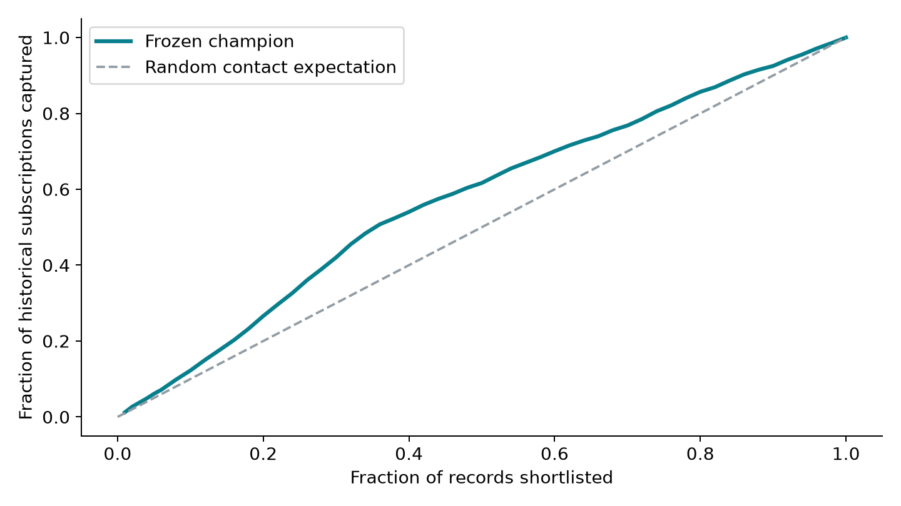
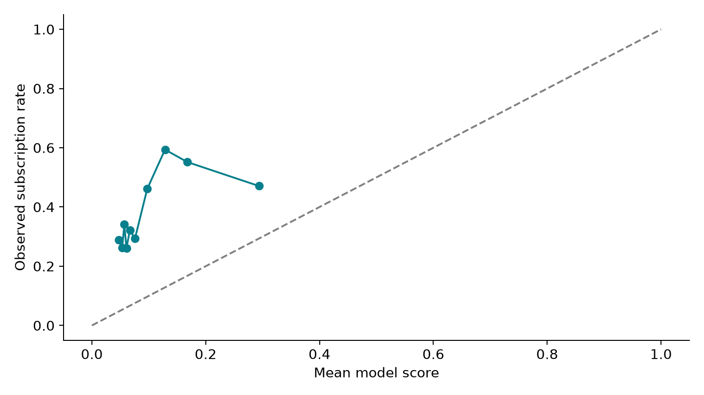

# Model report — Banking Customer Engagement & Deposit Propensity

**Model:** `rf-d8-l10-32e674d224`  
**Selection frozen:** 2026-10-19T14:59:50.284904+00:00  
**Test evaluation recorded:** 2026-10-19T15:00:08.898994+00:00  
**Use:** offline historical prioritization research and a simulated relationship-manager workflow.

## 1. Decision, population and evidence boundary

The validation-selected **Random Forest** captured **632 of 2,376** historical test subscriptions in the highest-scored **1,236 of 6,179 records**. Test Precision@20% was **51.13%**, Lift@20% **1.330×**, and Recall@20% **26.60%**. These are offline historical ranking results, not incremental sales.

The decision is which observations to review first when a team can discuss term deposits with only a limited fraction of its prospect pool. The output is a ranking and factual customer-history context. It supports a needs-based conversation; it is not a product recommendation or a suitability decision. No customers were contacted and no incremental sales, revenue or production impact were measured.

The exact source variant is UCI's `bank-additional-full.csv`: 41,188 observations, 20 source inputs and binary subscription target `y`, ordered by date from May 2008 to November 2010. These are Portuguese telephone campaigns. The row identifier is a surrogate observation ID, not evidence of a unique customer, household or account. The data lacks complete timestamps, contact permission, digital engagement, product value, contact cost and customer needs. Its selection into historical campaigns limits generalization to arbitrary prospects and present-day Indian banking.

## 2. Data preparation and quality

Acquisition selects exact basenames from the official nested archive without arbitrary extraction, enforces the 21-column/41,188-row contract, preserves original CSV bytes/readme, and records SHA-256 provenance. It rejects alternative older/sample variants, undocumented source categories, missing/nonfinite numeric fields and malformed numeric counts. Source text is normalized, `unknown` is retained, `y` is mapped to 0/1, and fixed age groups are added for descriptions. No row is removed or reordered to improve the result. Raw schema and source-wide quality inspection do not use held-out outcomes for model choices.

Quality inspection found **12 extra exact duplicate rows**, involving **24 rows**, and **0 exact duplicate fingerprints spanning more than one split.** Duplicates remain because identical observations need not be erroneous or the same person. An exact-row comparison cannot rule out repeated customers with different attributes across time. Contradictory history combinations are counted rather than corrected without evidence:

| Prior-history check | Flagged rows |
|---|---|
| previous_zero_but_pdays_not_999 | 0 |
| previous_positive_but_poutcome_nonexistent | 0 |
| previous_zero_but_poutcome_not_nonexistent | 0 |
| pdays_999_but_poutcome_success | 0 |

Unknown categories are not interpreted as negative answers:

| Source categorical field | Unknown count | Share of all rows |
|---|---|---|
| job | 330 | 0.80% |
| marital | 80 | 0.19% |
| education | 1,731 | 4.20% |
| default | 8,597 | 20.87% |
| housing | 990 | 2.40% |
| loan | 990 | 2.40% |

The normalized SQLite database contains raw and clean tables, a one-to-one split map, model-run metadata, canonical validation/test scores, and a clearly separate simulated-engagement table. Primary/foreign keys and integrity checks protect joins. Named SQL queries use bound split parameters; segment outputs retain counts and subscription numerators. Target-based exploratory analysis defaults to training, and the CLI gates held-out/full-history descriptions until selection has been frozen.

Training-only previous-outcome summary: `nonexistent`: 1,543 subscriptions / 27,829 observations (5.54%); `failure`: 56 subscriptions / 952 observations (5.88%); `success`: 7 subscriptions / 50 observations (14.00%). These are descriptive associations with explicit denominators.

## 3. Scoring time and leakage policy

Scoring occurs immediately before a proposed contact. The model assumes recorded customer profile and previous-campaign history were then available. This remains a retrospective approximation because feature-event timestamps are absent. The ten raw inputs are age; job, marital status and education; recorded credit default, housing loan and personal loan; prior contact count; prior campaign recency; and prior campaign outcome. Full definitions are in [the data dictionary](../docs/data_dictionary.md).

`duration` is excluded because it is observed after the call and would answer a different question. `contact`, `month`, `day_of_week` and `campaign` refer to the current/last contact; the source does not establish a pre-contact assignment or snapshot. The five macroeconomic fields are excluded in conservative v1 because release timing and revisions are not recorded. Target, row position, IDs, split and all simulation fields are never predictive inputs. The conservative design may sacrifice ranking performance compared with broader-feature published benchmarks; that is preferable to claiming unavailable information could drive the intended decision.

The saved scikit-learn Pipeline includes feature engineering, one-hot encoding, preprocessing and estimator. `pdays=999` creates `no_previous_contact=1`; its numerical recency is replaced with the median among observed training recencies, with a documented zero fallback only if none exist. Logistic Regression standardizes the four resulting numeric columns; the forest leaves their scales unchanged. Categories and scaler statistics are learned solely from training. Unknown/unseen categories remain scoreable through `handle_unknown='ignore'`, with batch diagnostics. The source `unknown` category remains a distinct recorded state.

## 4. Chronology, experiments and freeze

| Partition | Records | Source row IDs | Subscriptions | Rate |
|---|---|---|---|---|
| train | 28,831 | 1–28,831 | 1,606 | 5.57% |
| validation | 6,178 | 28,832–35,009 | 658 | 10.65% |
| test | 6,179 | 35,010–41,188 | 2,376 | 38.45% |

These are contiguous partitions using floor(70%), floor(15%) and the remainder. There is no shuffled stratification, oversampling or train/test mixing. Supplied order approximates future use but does not create exact timestamps or customer groups that the source does not contain. Label prevalence across the blocks is observed only for final reporting after the policy is fixed.

The bounded search was fixed in advance:

| Family | Candidates and fixed controls |
|---|---|
| Logistic Regression | `C ∈ {0.01, 0.1, 1, 10}`; L2, `lbfgs`, `max_iter=2000`, no class weighting; training-only scaling and encoding. |
| Random Forest | `max_depth ∈ {8, None} × min_samples_leaf ∈ {10, 50}`; 300 trees, sqrt feature sampling, no class weighting, seed 42, bounded parallelism. |
| Prior baseline | `DummyClassifier(strategy='prior')`; training subscription prevalence for every row. |

Within each learner family, choose the greatest validation Precision@20%, then AP. Between the two learner finalists, use the same criteria, then prefer Logistic Regression if equal, then stable candidate ID. Metric differences within 1e-12 are treated as ties. The prior baseline is retained as a reference, not a competitor that silently replaces the trained champion. A learner that fails to beat the baseline must still be reported honestly.

The frozen champion is **Random Forest**, parameters `{"class_weight": null, "max_depth": 8, "max_features": "sqrt", "min_samples_leaf": 10, "n_estimators": 300, "n_jobs": 2, "random_state": 42}`. Its validation Precision@20% was **18.69%**, AP **0.1907**. The complete champion and one finalist per family were saved before final evaluation. The champion was not refitted on train plus validation; preserving the exact selected fitted pipeline avoids changing its score/cutoff after the freeze. The test set evaluates those frozen finalists and cannot select another model.

The freeze manifest records exact features/exclusions, configuration, dependency versions, source/split hashes, code fingerprint, candidate identity, model hashes, tie policy and cutoff. Repeated train/evaluate commands validate the manifest and reuse matching results. Changed model code/data/artifacts require a disclosed new experiment; the guards are provenance controls, not proof against deliberate manual tampering.

## 5. Metrics, results and capacity interpretation

| Split / model | PR-AUC¹ | AP² | ROC-AUC | Precision@20% | Lift@20% | Recall@20% | Captured / shortlisted | Brier ↓ |
|---|---|---|---|---|---|---|---|---|
| validation / Logistic Regression | 0.1669 | 0.1682 | 0.6001 | 17.15% | 1.610 | 32.22% | 212 / 1,236 | 0.0959 |
| test / Logistic Regression | 0.5223 | 0.5226 | 0.6219 | 59.95% | 1.559 | 31.19% | 741 / 1,236 | 0.3060 |
| validation / Random Forest ★ | 0.1896 | 0.1907 | 0.6206 | 18.69% | 1.755 | 35.11% | 231 / 1,236 | 0.0949 |
| test / Random Forest ★ | 0.4737 | 0.4740 | 0.6186 | 51.13% | 1.330 | 26.60% | 632 / 1,236 | 0.3092 |
| validation / Prior baseline | 0.5533 | 0.1065 | 0.5000 | 11.08% | 1.041 | 20.82% | 137 / 1,236 | 0.0977 |
| test / Prior baseline | 0.6923 | 0.3845 | 0.5000 | 37.62% | 0.978 | 19.57% | 465 / 1,236 | 0.3448 |

**The held-out comparison matters:** Logistic Regression achieved 59.95% test Precision@20%, 1.559× lift and 31.19% recall. The released Random Forest remains the choice fixed on validation (18.69% precision, versus 17.15% for Logistic Regression); we do not switch to the better-looking test model after seeing the holdout. This reversal is a limitation to explain, not a result to hide.

**Substantial temporal shift:** subscription prevalence was 5.57% (train) → 10.65% (validation) → 38.45% (test). A higher later-period precision does not itself show an improved model. Ranking generalization is limited, and the scores should not be presented as calibrated personal probabilities.

★ indicates the validation-selected champion. **¹ PR-AUC** is the trapezoidal integral of points from `precision_recall_curve`; **² AP** is scikit-learn's non-interpolated average precision. They are different summaries and are not substituted for one another. AP is the selection tie-breaker; the requested PR-AUC is separately reported. [Scikit-learn metric definition](https://scikit-learn.org/stable/modules/generated/sklearn.metrics.average_precision_score.html).

For an all-test budget of 20%, `k = ceil(0.20 × 6,179) = 1,236`. Sort descending score; resolve ties by ascending SHA-256 of `42:<record_id>`, then ID. Precision is the 632 captured subscriptions divided by k. Recall divides captured subscriptions by all 2,376 test subscriptions. Lift divides precision by the 38.45% overall test rate. Actual coverage is 20.00% because of rounding.

The prior baseline provides constant scores and therefore ROC-AUC 0.5 on a two-class set; its exact top-k result depends on the fixed label-independent tie subset. In this run baseline top-20% precision is 37.62%, lift 0.978 and recall 19.57%. Analytical random-contact expectation is base-rate precision, unit lift and approximately budget-fraction recall; it is shown as an expectation, not a fabricated sampled experiment. A degenerate constant-score curve can yield a trapezoidal PR-AUC unlike its AP, which is another reason to label both definitions.

The frozen validation cutoff is **0.067922**. Applying `score >= cutoff` on test selected **3,336** records (53.99% coverage), with 46.64% precision and 65.49% recall. This is a separate policy from the exact top-20% shortlist. Ties at the cutoff can increase its volume; a new population can change it further.

Official all-test metrics are computed **without simulated suppression**. In the operational demonstration, apply simulated rules first, then compute capacity as a fraction of the remaining eligible pool or a capped integer. An optional frozen cutoff can leave capacity unused. These different denominators must not be mixed. Changing UI capacity, filters or simulation does not rerun the locked model comparison.

No confidence interval or significance claim is made. Without real customer IDs, an independent-row bootstrap could understate uncertainty from repeat customers and temporal dependence. Rounded point estimates are offline summaries. A present-day deployment would require prospective evidence rather than extrapolating this single temporal holdout.

## 6. Explanation, reliability, drift and group review

Raw-feature permutation importance shuffles one original input on validation, measures the AP decrease, repeats ten times with seed 42, and uses the frozen champion. It does not refit the model or inspect test data to tune it. Correlated fields can share importance; negative values are valid. These are global predictive sensitivities, not causal effects or individualized reasons:

| Raw feature | Mean validation AP decrease | Repeat SD |
|---|---|---|
| age | 0.0296 | 0.0023 |
| pdays | 0.0132 | 0.0020 |
| job | 0.0070 | 0.0028 |
| default | 0.0057 | 0.0019 |
| education | 0.0046 | 0.0028 |
| poutcome | 0.0038 | 0.0017 |
| housing | 0.0007 | 0.0011 |
| loan | -0.0003 | 0.0006 |
| previous | -0.0025 | 0.0013 |
| marital | -0.0029 | 0.0027 |

The interface instead gives a prospect's factual prior-history context and clear simulation reasons. It does not claim “this customer subscribed because of age” or invent a personalized SHAP explanation. The relationship-manager prompt asks about saving goals, liquidity needs, tenure preference and willingness to discuss a product.

Reliability uses ten quantile bins of test scores versus observed subscription rates; Brier score is 0.3092. No probability calibrator is fitted in v1. These diagnostics distinguish useful ordering from trustworthy probability estimates. The split-rate table documents temporal prevalence shift. Without complete dates or feature-release history, it is not possible to attribute drift to one macroeconomic event or estimate a release-aligned backtest.

Descriptive audits apply the same frozen global top-20% selection across age/job groups, rather than silently allocating a separate 20% to each group. Counts remain visible. Base and selection rates require n≥30; precision requires selected n≥30; recall requires at least ten group subscriptions. Unsupported rates are suppressed rather than overinterpreted. Age results are below; full job results are in `demo/group_audit.csv` and the application.

| Age group | n | Subscriptions | Selected | Base rate | Selection rate | Precision | Recall |
|---|---|---|---|---|---|---|---|
| 30–44 | 2586 | 933 | 135 | 36.08% | 5.22% | 65.93% | 9.54% |
| 45–59 | 1337 | 507 | 47 | 37.92% | 3.52% | 80.85% | 7.50% |
| 60+ | 845 | 388 | 738 | 45.92% | 87.34% | 47.97% | 91.24% |
| under 30 | 1411 | 548 | 316 | 38.84% | 22.40% | 47.78% | 27.55% |

Differences can reflect historical selection, recorded profiles, outcomes, sparse data or model behavior. They do not certify fairness, nondiscrimination, legal compliance or suitability. The data does not contain every relevant group attribute, and demographic proxies remain possible.

## 7. Engagement policy, artifact safety and reproduction

The simulation is deliberately separate from modeling: SHA-256-derived demonstration flags represent opt-out, permission and recent contact. Opt-out, absent simulated permission, recent contact and missing simulation fields suppress outreach regardless of score; all failed reasons are retained. The nominal hash cutoffs do not imply real consent rates or a real bank policy. No app, push, email or SMS outcome is learned from telephone records.

The app verifies demo-file hashes and exact key package versions before loading its trusted pipeline. It never loads user-uploaded serialized models or trains on startup. Batch validation is atomic, safe exports omit y and personal contact details, and uploads remain in memory. The CLI outputs only the requested safe score table and companion metadata. These prototype controls do not substitute for production privacy, access management, retention rules or independent validation.

Reproduce from the README's Python 3.11 locked environment using `fetch-data`, `prepare`, `analyze --split train`, `train`, `evaluate --split test`, `package-demo`, then `python scripts/build_docs.py`. Execute `ruff check .` and `pytest -q`; CI configuration runs repository checks. Test execution evidence should be read from the actual run/CI, rather than inferred from the presence of tests. Source provenance and model environment are below:

| Evidence | Exact value |
|---|---|
| CSV SHA-256 | `74adfc578bf77a7ff4bb1ba4a9f8709d9e3c6907342959c2c8416847e0afb4d8` |
| Split map SHA-256 | `6d337475d5e0346885ea043a63b728a913a0da80f78dd82c80bd6f2255a10853` |
| Selection JSON SHA-256 | `e8ff713bc495366e6592fb13d4c3cd7afeabc79cb74ccc4fedb837a22be7f889` |
| Model code fingerprint | `78e20897d0dd46e6a7ac4bd695c5bf33007c2cd6ed670ea5639f6a4554bcacb7` |
| Champion artifact SHA-256 | `5bbd52c9b03866444bdecfe0f4440f79e301758c3ac279ec7f2dcf00f0ce6cb6` |
| Seed | 42 |
| Local training commit | `f8b37b3663039a13dd17523d6c890e3ff1be5e19` |

The training commit was captured in the local authoring checkout. It is not asserted to exist in the public GitHub history or to identify the published release. The source/split hashes, modeling-code fingerprint and serialized-model checksum above identify the exact experimental inputs and outputs.

Dependency versions: `{"joblib": "1.6.0", "numpy": "2.4.6", "pandas": "2.3.3", "scikit-learn": "1.7.2", "scipy": "1.17.1", "streamlit": "1.66.0"}`. Timestamps and commit metadata may differ in a fresh disclosed run; model ID incorporates data, configuration, relevant code and dependency versions. Prediction reproduction should be checked with the locked environment and verified input hashes; cross-platform numerical differences are possible. Serialization scores are verified on a fixed sample within 1e-12 by the project checks.

## 8. Limits and next responsible experiment

Historical subscription propensity is not uplift: a high-scoring customer may have subscribed without an additional contact. There is no untreated comparison, randomized assignment, deposit amount or cost record. Consequently, do not turn captured historical labels into incremental conversions, revenue, ROI or a guaranteed campaign gain. Do not claim an optimal digital channel from telephone history.

The project demonstrates a functioning analytics-to-review workflow, SQL discipline, leakage-aware ML and honest communication. For real use, first obtain contemporary permissioned data and timestamped pre-contact snapshots, validate customer-level and temporal splits, review suitability/engagement policies with accountable teams, assess support and disparities, and evaluate contact benefit in a controlled prospective pilot. Monitor input/schema drift, prevalence, ranking, calibration, suppression and outcomes with a versioned rollback path. This is an independent prototype, not a model deployed at or endorsed by ICICI Bank.

Data sources and credit: [UCI Bank Marketing](https://archive.ics.uci.edu/dataset/222/bank+marketing), the official additional-dataset readme, and [DATA_LICENSE.md](../DATA_LICENSE.md). The report's numerical sections are generated from frozen project artifacts, not estimates or illustrative examples.
